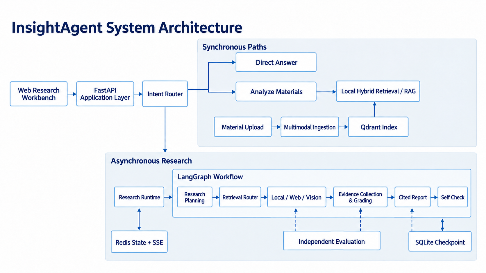

# InsightAgent

English | [简体中文](./README.zh.md)

InsightAgent is a multimodal research agent that combines material ingestion and indexing, knowledge retrieval, multi-step research planning, multi-source evidence processing, cited reports, automated self-checks, and research-run management. It ships as a complete local MVP with a Next.js research workbench and FastAPI HTTP/SSE APIs.

The project is designed for reproducible local research workflows. Direct answers and document analysis complete synchronously, while deep research runs as an observable, resumable workflow. The current release is intended for local development, demonstrations, and engineering evaluation—not as a secure public multi-user service.

## System Architecture



`POST /v1/query` first passes through the Intent Router. `direct` and `analyze` are synchronous paths that return HTTP 200 without creating a Research Run. `research` returns HTTP 202 with a `run_id`; the Research Runtime executes the LangGraph workflow and exposes progress through status and SSE endpoints. Integrations can call `POST /v1/research/runs` to create a Research Run deterministically.

## Core Capabilities

- **Multimodal material ingestion and indexing:** controlled uploads for Markdown, text, and PDF, plus PNG, JPEG, and WebP when a Vision Provider is configured. Content-addressed materials are chunked, embedded, and indexed in local Qdrant.
- **Hybrid retrieval and RAG:** Dense and BM25 retrieval run in parallel, Reciprocal Rank Fusion (RRF) combines their rankings, and a Cross-Encoder Reranker produces the final ranking.
- **Intent routing and research planning:** Direct, Analyze, and Research are distinct execution paths. Deep research decomposes work into tasks and routes each task across available Local, Web, and Vision sources.
- **Evidence processing:** retrieved items become unified Evidence, then pass task-scope validation, deduplication, and sufficiency grading. Insufficient evidence can trigger bounded query refinement and collection rounds.
- **Cited reports and Self Check:** validated evidence is converted into structured Claims; citations are assembled deterministically and rendered as Markdown. A Self Check runs before final output and allows only bounded report repair.
- **Observable, resumable Research Runs:** Redis stores public run state and replayable SSE events. SQLite stores LangGraph checkpoints used to resume `interrupted` or `timed_out` runs.
- **Web research workbench:** material upload, smart queries, explicit deep research, live run inspection, Markdown/GFM reports, source navigation, and Resume.
- **Independent Evaluation Harness:** retrieval, evidence, answer, and structural evaluation with versioned results, explicit baselines, and regression reports. Recorded offline fixtures are kept distinct from real-provider execution.

## Interface Preview

The repository does not currently contain real UI screenshots suitable for the project page. These slots are intentionally text-only until actual demonstration captures are added:

> **Screenshot placeholder: InsightAgent research workbench.** Suggested content: materials panel, Smart/Deep Research modes, and service readiness.

> **Screenshot placeholder: live Research Run.** Suggested content: Run ID, status, SSE events, and progress after reconnection.

> **Screenshot placeholder: final report and citations.** Suggested content: Markdown report body, numbered citations, and source navigation.

## Technology Stack

| Layer | Current implementation |
|---|---|
| Frontend | Next.js 16.4, React 19.3, TypeScript 5.9, Tailwind CSS 4, Zod, React Markdown, Vitest, Testing Library, MSW |
| Backend | Python 3.11+, FastAPI, Uvicorn, OpenAI-compatible Chat Completions, HTTPX, PyMuPDF, Beautiful Soup |
| Retrieval | Sentence Transformers, BAAI/bge-m3 default embeddings, local Qdrant, BM25, jieba, RRF, Cross-Encoder Reranker |
| Runtime | LangGraph, Redis, SSE, SQLite checkpoints |
| Evaluation | Standalone `evals` package, versioned JSONL datasets, recorded fixtures, explicit baselines, regression policies, and JSON/Markdown reports |

See [`pyproject.toml`](./pyproject.toml) and [`frontend/package.json`](./frontend/package.json) for the authoritative dependency ranges.

## Quick Start

### 1. Clone the repository

```bash
git clone https://github.com/sweeter-byte/InsightAgent.git
cd InsightAgent
```

### 2. Create the Python environment and install dependencies

Python 3.11 or newer is required. This project uses Conda and does not create a project `.venv`.

```bash
conda env list
conda create -n insight-agent python=3.11
conda run --no-capture-output -n insight-agent \
  python -m pip install -e ".[dev]"
```

If the named environment already exists, keep it; do not update packages in an unconfirmed environment.

### 3. Configure environment variables

```bash
cp .env.example .env
```

Set at least the following required values, and never commit real API keys:

```dotenv
LLM_API_KEY=replace-me
LLM_BASE_URL=https://your-openai-compatible-host/v1
LLM_MODEL=your-tool-capable-model
RERANKER_MODEL=BAAI/bge-reranker-v2-m3
```

Configuration boundaries:

| Capability | Configuration | Requirement |
|---|---|---|
| LLM | `LLM_API_KEY`, `LLM_BASE_URL`, `LLM_MODEL` | **Required.** The endpoint must support Chat Completions; the model must support Analyze tool calls and Research structured decisions. |
| Embeddings | `EMBEDDING_MODEL` | **Required local model**, defaulting to `BAAI/bge-m3`; no API key is needed, but weights may download on first use. |
| Reranker | `RERANKER_MODEL` | **Required** with no non-empty built-in default. `BAAI/bge-reranker-v2-m3` is the recommended bilingual model; weights may download on first use. |
| Vision | `VISION_API_KEY`, `VISION_BASE_URL`, `VISION_MODEL` | **Optional.** All three enable image ingestion and Vision Retrieval. |
| Web Search | `TAVILY_API_KEY` | **Optional.** Web becomes an available Research source only when configured. |

See [`.env.example`](./.env.example) for paths, retrieval depths, upload limits, and Runtime settings. Provision the embedding and reranker model caches before running offline.

### 4. Start Redis

In the first terminal:

```bash
redis-server --port 6379
```

The default connection is `redis://localhost:6379/0`; override it with `RUNTIME_REDIS_URL`.

### 5. Start FastAPI

In the second terminal:

```bash
conda run --no-capture-output -n insight-agent \
  python -m uvicorn insight_agent.runtime.app:app \
  --host 127.0.0.1 --port 8000
```

Check the service:

```bash
curl --fail http://127.0.0.1:8000/health
curl --fail http://127.0.0.1:8000/ready
```

`/health` checks process liveness. `/ready` checks Redis, Qdrant, checkpoints, and configuration, and reports the availability of optional Web and Vision components.

### 6. Install and start the frontend

Node.js 20.9 or newer is required. In the third terminal:

```bash
cd frontend
npm ci
npm run dev
```

Open <http://127.0.0.1:3000>. The frontend proxies `/health`, `/ready`, and `/v1/*` to `http://127.0.0.1:8000` by default. Set `INSIGHTAGENT_BACKEND_ORIGIN` before development or build commands to use another backend origin.

## Usage

1. **Upload material:** upload a supported file in the left panel. The API returns after ingestion, indexing, and BM25 snapshot refresh. The same flow is available through HTTP:

   ```bash
   curl --fail \
     -F 'file=@examples/chapter18_demo_material.md;type=text/markdown' \
     http://127.0.0.1:8000/v1/materials
   ```

2. **Ask a smart question:** select Smart Query and submit a prompt. `POST /v1/query` returns Direct/Analyze results synchronously or a Research `run_id` asynchronously.
3. **Run deep research:** select Deep Research to create a multi-step Research Run explicitly, without relying on intent classification to enter the research path.
4. **Observe the run:** the right panel shows authoritative run state and SSE events, including deduplication, `Last-Event-ID` reconnection, and terminal-state reconciliation.
5. **Read the report:** after completion, the center panel renders the GFM Markdown in `final_output`, preserves inline citation numbers, and shows source navigation when sources can be extracted safely.
6. **Resume work:** use the UI for an `interrupted` or `timed_out` run, or call:

   ```bash
   curl --fail -X POST \
     http://127.0.0.1:8000/v1/research/runs/<run_id>/resume
   ```

Primary integration endpoints:

| Method | Path | Purpose |
|---|---|---|
| `POST` | `/v1/materials` | Multipart material ingestion and indexing |
| `POST` | `/v1/query` | Unified Direct / Analyze / Research entry point |
| `POST` | `/v1/research/runs` | Explicit asynchronous Research creation |
| `GET` | `/v1/research/runs/{run_id}` | Run state and final report |
| `GET` | `/v1/research/runs/{run_id}/events` | SSE progress and replay |
| `POST` | `/v1/research/runs/{run_id}/resume` | Resume interrupted or timed-out work |

Every HTTP response includes `X-Request-ID`.

## Evaluation

The top-level [`evals`](./evals) package is a standalone evaluation module covering Retrieval, Evidence, Answer, and structural checks. It records dataset, prompt, model, index, and retrieval-configuration fingerprints.

The following command runs deterministic **Mock Evaluation** with a recorded fixture. It does not need Redis, FastAPI, or external APIs:

```bash
conda run --no-capture-output -n insight-agent python -m evals \
  --dataset eval_data/research_eval_smoke_v1.jsonl \
  --fixture evals/fixtures/smoke_v1.json \
  --mode offline \
  --output /tmp/insight-agent-eval/runs \
  --run-id readme-candidate
```

The CLI explicitly labels this output `MOCK TEST`. It validates the evaluation pipeline, result format, and regression policy; it is **not a measure of real Research Agent quality or success rate**. The current fixture CLI never silently substitutes mock components for Live evaluation; real-model/retriever evaluation requires explicit real-component wiring. Provider-backed Research in [`examples/chapter18_demo.sh`](./examples/chapter18_demo.sh) is a separate manual smoke test and must not be reported as an offline Mock metric.

Baseline registration and candidate comparison are explicit operations; see [`examples/chapter18_demo.sh`](./examples/chapter18_demo.sh) for the complete commands.

### BEIR SciFact retrieval benchmark

The real SciFact adapter is separate from Mock Evaluation. BEIR loads the
official test split and computes NDCG@10, Recall@5/10, and MRR@10; retrieval is
performed by InsightAgent's own Dense, BM25, RRF, and Cross-Encoder components.
Install its optional dependencies without changing the normal installation:

```bash
pip install -e ".[benchmark]"
```

BEIR 2.2 supports Python 3.9–3.12 and declares unpinned dependencies on
`sentence-transformers`, `datasets`, and `pytrec-eval-terrier`. Before installing
into an existing GPU environment, inspect the resolver plan and ensure it does
not replace the environment's working PyTorch/CUDA packages. The benchmark
script never installs, upgrades, or downgrades dependencies.

Run each stage explicitly from any directory:

```bash
scripts/benchmarks/scifact.sh prepare
scripts/benchmarks/scifact.sh index
scripts/benchmarks/scifact.sh smoke
scripts/benchmarks/scifact.sh full
scripts/benchmarks/scifact.sh report eval_results/benchmarks/beir_scifact/<run_id>
```

`full` is never run automatically. `smoke` uses the complete official corpus
but only a deterministic small query subset and labels all output as non-formal.
Defaults can be overridden with command-line flags or `SCIFACT_*` environment
variables; run `scripts/benchmarks/scifact.sh <command> --help` for the exact
surface. The script uses the active `python` executable, or
`SCIFACT_PYTHON` when explicitly set.

Data and the isolated Qdrant index live under
`.data/benchmarks/beir_scifact/`. Runs are written to
`eval_results/benchmarks/beir_scifact/<run_id>/` with `manifest.json`,
`metrics.json`, `predictions.jsonl`, `bad_cases.json`, `summary.md`, and
`benchmark.log`. An incomplete run retains predictions and is marked failed;
it never publishes partial metrics as a completed result.

SciFact qrels are document-level while InsightAgent retrieves chunks. The
adapter preserves `metadata["beir_doc_id"]`, collapses duplicate chunks at the
first occurrence, and evaluates the resulting unique-document Top-10. This is
therefore a document-level evaluation of InsightAgent's chunk index, not the
official BEIR model configuration. The report discloses chunking, candidate
depths, models, index fingerprint, rank-preserving BEIR scores, and stage timing
semantics.

## Tests and Project Status

Backend test entry point:

```bash
conda run --no-capture-output -n insight-agent python -m pytest -q
```

Frontend validation entry points:

```bash
cd frontend
npm run typecheck
npm run lint
npm test
npm run test:sse-proxy
npm run build
```

`npm run test:sse-proxy` uses controlled local services to verify first-frame streaming, headers, `Last-Event-ID`, and downstream cancellation without creating a paid Research Run.

The backend and frontend MVP are implemented. The project completed real-browser end-to-end acceptance before this documentation pass; that is a historical acceptance result, not a claim about commands run during this pass. This documentation task does not rerun paid provider research and does not claim new benchmark scores, success rates, or production deployment metrics.

## Known Limitations

- There is no authentication, authorization, user system, rate limiting, or multi-user isolation. Do not expose the service directly to an untrusted public network.
- The local knowledge base is a collection shared by all requests; there is no material-, session-, or user-level isolation.
- The Query contract cannot restrict retrieval by `material_id`.
- The backend has no material-list endpoint. The frontend retains uploads only for the current page, so the list cannot be restored after a refresh.
- Web Research depends on an external Provider. Without a valid configuration—or while that Provider is unavailable—Web is not an available research source.
- The Research Runtime targets a single process and has no distributed worker queue. SQLite checkpoints are local files and do not support direct horizontal scaling.
- The frontend restores only the latest Run ID from `sessionStorage`; it cannot restore the original prompt or complete research history.

## Third-party Sources

See [`frontend/THIRD_PARTY_NOTICES.md`](./frontend/THIRD_PARTY_NOTICES.md) for frontend design references and third-party license notices.
