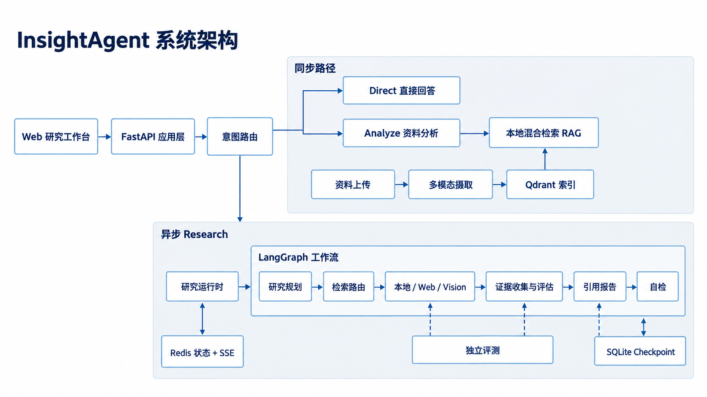

# InsightAgent

[English](./README.md) | 简体中文

InsightAgent 是一个多模态研究智能体（Multimodal Research Agent）。它将资料摄取与索引、知识库检索、多步研究规划、多来源证据处理、引用报告、自动检查和研究任务运行管理组合为一个可在本地运行的完整 MVP，并提供 Next.js 研究工作台与 FastAPI HTTP/SSE 接口。

项目面向可复现的本地研究流程：普通问答和资料分析在请求内同步完成；深度研究进入可观察、可恢复的异步工作流。当前版本适合本地开发、演示和工程验证，不应直接作为安全的公网多用户服务部署。

## 系统架构



`POST /v1/query` 先经过 Intent Router。`direct` 与 `analyze` 是同步路径，返回 HTTP 200，不创建 Research Run；`research` 返回 HTTP 202 与 `run_id`，由 Research Runtime 执行 LangGraph 工作流，并通过状态接口与 SSE 暴露进度。也可以调用 `POST /v1/research/runs` 确定性地创建 Research Run。

## 核心功能

- **多模态资料导入与索引**：受控上传 Markdown、纯文本和 PDF；配置 Vision Provider 后可处理 PNG、JPEG 与 WebP。资料按内容寻址，经切块、Embedding 和本地 Qdrant 建立共享索引。
- **混合检索与 RAG**：并行执行 Dense 与 BM25 检索，通过 Reciprocal Rank Fusion（RRF）融合，再由 Cross-Encoder Reranker 精排，而不是只依赖单一路径的向量相似度。
- **意图路由与研究规划**：区分 Direct、Analyze 和 Research；深度研究会拆解任务，并按任务在 Local、Web、Vision 等可用来源之间路由。
- **证据处理**：检索结果先转换为统一 Evidence，经过任务范围校验、去重与充分性评估；不足时可在受限轮次内改写检索并继续收集。
- **引用报告与 Self Check**：从通过评估的证据生成结构化 Claim，确定性装配引用并渲染 Markdown；最终输出前执行 Self Check，并只允许有边界的报告修复。
- **可观察、可恢复的 Research Run**：Redis 保存公开运行状态与 SSE 事件，支持事件 ID 重放；SQLite 保存 LangGraph Checkpoint，可恢复 `interrupted` 或 `timed_out` Run。
- **Web 研究工作台**：支持资料上传、智能提问、显式深度研究、运行状态和事件查看、Markdown/GFM 报告、来源导航及 Resume。
- **独立 Evaluation Harness**：覆盖检索、证据、答案、结构检查、版本化结果、显式 Baseline 与 Regression 报告；离线 Fixture 与真实 Provider 运行严格区分。

## 界面展示

仓库目前没有可直接引用的真实界面截图。以下位置保留给实际演示素材，不使用生成图或不存在的文件路径：

> **截图占位：InsightAgent 研究工作台。** 建议展示资料区、智能提问/深度研究切换和服务就绪状态。

> **截图占位：Research Run 实时执行。** 建议展示 Run ID、状态、SSE 事件与断线恢复后的进度。

> **截图占位：最终研究报告与引用。** 建议展示 Markdown 报告正文、编号引用和右侧来源导航。

## 技术栈

| 层级 | 当前实现 |
|---|---|
| Frontend | Next.js 16.4、React 19.3、TypeScript 5.9、Tailwind CSS 4、Zod、React Markdown、Vitest、Testing Library、MSW |
| Backend | Python 3.11+、FastAPI、Uvicorn、OpenAI-compatible Chat Completions、HTTPX、PyMuPDF、Beautiful Soup |
| Retrieval | Sentence Transformers、BAAI/bge-m3（默认 Embedding）、Qdrant Local、BM25、jieba、RRF、Cross-Encoder Reranker |
| Runtime | LangGraph、Redis、SSE、SQLite Checkpoint |
| Evaluation | 独立 `evals` 包、版本化 JSONL Dataset、Recorded Fixture、显式 Baseline、Regression Policy 与 JSON/Markdown 报告 |

依赖版本范围以 [`pyproject.toml`](./pyproject.toml) 和 [`frontend/package.json`](./frontend/package.json) 为准。

## Quick Start

### 1. 克隆仓库

```bash
git clone https://github.com/sweeter-byte/InsightAgent.git
cd InsightAgent
```

### 2. 创建 Python 环境并安装依赖

需要 Python 3.11 或更高版本。本项目使用 Conda，不创建项目 `.venv`。

```bash
conda env list
conda create -n insight-agent python=3.11
conda run --no-capture-output -n insight-agent \
  python -m pip install -e ".[dev]"
```

如果已存在同名环境，请保留它；不要在未确认的环境中更新依赖。

### 3. 配置环境变量

```bash
cp .env.example .env
```

至少填写以下必需项，不要提交真实 API Key：

```dotenv
LLM_API_KEY=replace-me
LLM_BASE_URL=https://your-openai-compatible-host/v1
LLM_MODEL=your-tool-capable-model
RERANKER_MODEL=BAAI/bge-reranker-v2-m3
```

配置边界如下：

| 能力 | 配置 | 要求 |
|---|---|---|
| LLM | `LLM_API_KEY`、`LLM_BASE_URL`、`LLM_MODEL` | **必需**。端点需兼容 Chat Completions；模型需支持 Analyze 的 Tool Calling 和 Research 的结构化决策。 |
| Embedding | `EMBEDDING_MODEL` | **必需的本地模型**，默认 `BAAI/bge-m3`，无需 API Key；首次运行可能下载权重。 |
| Reranker | `RERANKER_MODEL` | **必需**且无内置非空默认值；推荐双语模型 `BAAI/bge-reranker-v2-m3`，首次运行可能下载权重。 |
| Vision | `VISION_API_KEY`、`VISION_BASE_URL`、`VISION_MODEL` | **可选**，三项全部配置后启用图片摄取与 Vision Retrieval。 |
| Web Search | `TAVILY_API_KEY` | **可选**，配置后 Web 才会成为 Research 的可用来源。 |

其余路径、检索深度、上传限制和 Runtime 参数见 [`.env.example`](./.env.example)。离线环境应提前准备 Embedding 与 Reranker 模型缓存。

### 4. 启动 Redis

在第一个终端执行：

```bash
redis-server --port 6379
```

默认连接为 `redis://localhost:6379/0`，可通过 `RUNTIME_REDIS_URL` 修改。

### 5. 启动 FastAPI

在第二个终端执行：

```bash
conda run --no-capture-output -n insight-agent \
  python -m uvicorn insight_agent.runtime.app:app \
  --host 127.0.0.1 --port 8000
```

检查服务：

```bash
curl --fail http://127.0.0.1:8000/health
curl --fail http://127.0.0.1:8000/ready
```

`/health` 仅检查进程存活；`/ready` 检查 Redis、Qdrant、Checkpoint 和配置，并报告 Web/Vision 可选组件是否可用。

### 6. 安装并启动前端

需要 Node.js 20.9 或更高版本。在第三个终端执行：

```bash
cd frontend
npm ci
npm run dev
```

浏览器访问 <http://127.0.0.1:3000>。前端默认把 `/health`、`/ready` 和 `/v1/*` 代理到 `http://127.0.0.1:8000`；使用其他后端地址时，在启动或构建前设置 `INSIGHTAGENT_BACKEND_ORIGIN`。

## 使用方式

1. **上传资料**：在左侧资料区上传支持的文件；接口完成摄取、索引和 BM25 快照刷新后返回结果。也可以使用：

   ```bash
   curl --fail \
     -F 'file=@examples/chapter18_demo_material.md;type=text/markdown' \
     http://127.0.0.1:8000/v1/materials
   ```

2. **智能提问**：选择“智能提问”并提交问题。`POST /v1/query` 根据意图同步返回 Direct/Analyze 结果，或异步返回 Research 的 `run_id`。
3. **深度研究**：选择“深度研究”，显式创建多步 Research Run，不依赖意图分类决定是否进入研究路径。
4. **观察运行状态**：右侧显示权威 Run 状态和 SSE 事件；客户端支持事件去重、`Last-Event-ID` 重连和终态校准。
5. **阅读报告**：完成后，中栏渲染 `final_output` 中的 GFM Markdown，保留正文引用编号，并在能够可靠提取时显示来源导航。
6. **恢复任务**：`interrupted` 或 `timed_out` 状态可在页面点击恢复，或调用：

   ```bash
   curl --fail -X POST \
     http://127.0.0.1:8000/v1/research/runs/<run_id>/resume
   ```

用于集成的主要 HTTP 路径为：

| 方法 | 路径 | 用途 |
|---|---|---|
| `POST` | `/v1/materials` | Multipart 资料导入与索引 |
| `POST` | `/v1/query` | Direct / Analyze / Research 统一入口 |
| `POST` | `/v1/research/runs` | 显式创建异步 Research |
| `GET` | `/v1/research/runs/{run_id}` | 读取状态与最终报告 |
| `GET` | `/v1/research/runs/{run_id}/events` | 读取/重放 SSE 事件 |
| `POST` | `/v1/research/runs/{run_id}/resume` | 恢复中断或超时任务 |

所有 HTTP 响应均包含 `X-Request-ID`。

## Evaluation

仓库顶层 [`evals`](./evals) 是独立评测模块，覆盖 Retrieval、Evidence、Answer 和结构检查，并记录 Dataset、Prompt、Model、Index 与检索配置指纹。

以下命令运行确定性的 **Mock Evaluation**。它使用 Recorded Fixture，不需要 Redis、FastAPI 或外部 API：

```bash
conda run --no-capture-output -n insight-agent python -m evals \
  --dataset eval_data/research_eval_smoke_v1.jsonl \
  --fixture evals/fixtures/smoke_v1.json \
  --mode offline \
  --output /tmp/insight-agent-eval/runs \
  --run-id readme-candidate
```

CLI 会明确输出 `MOCK TEST`。该结果用于验证评测管线、结果格式和回归规则，**不能作为真实 Research Agent 的能力或成功率指标**。当前 Fixture CLI 不会把 Mock 组件静默替换成 Live 运行；真实模型/检索器评测需要显式组装真实组件。`examples/chapter18_demo.sh` 中的 Provider-backed Research 属于手动 Smoke Test，也不能与离线 Mock 指标混为一谈。

Baseline 注册与候选比较是显式操作，完整命令可参考 [`examples/chapter18_demo.sh`](./examples/chapter18_demo.sh)。

## 测试与项目状态

后端测试入口：

```bash
conda run --no-capture-output -n insight-agent python -m pytest -q
```

前端验证入口：

```bash
cd frontend
npm run typecheck
npm run lint
npm test
npm run test:sse-proxy
npm run build
```

`npm run test:sse-proxy` 使用受控本地服务验证 SSE 首帧流式传输、请求头、`Last-Event-ID` 和下游取消，不创建收费 Research Run。

当前仓库状态为前后端 MVP 已实现。项目在本轮文档收尾前已完成真实浏览器端到端验收；这是历史验收结论，不等同于本轮命令执行结果。本轮文档验证不重新发起收费 Provider Research，也不声称新的 Benchmark、成功率或线上部署指标。

## 已知限制

- 当前没有认证、授权、用户系统、限流或多用户隔离，不应直接暴露到不可信公网。
- 本地知识库是所有请求共享的集合，不提供资料级、会话级或用户级隔离。
- Query 合同不支持按 `material_id` 限制检索。
- 后端没有资料列表查询接口；前端只保存当前页面的上传结果，刷新后不能恢复资料列表。
- Web Research 依赖外部 Provider；未配置或 Provider 不可用时，Web 不是可用研究来源。
- Research Runtime 面向单进程运行，没有分布式 Worker Queue；SQLite Checkpoint 也是本地文件，不支持直接水平扩容。
- 前端只在 `sessionStorage` 中恢复最近一次 Run ID，不能恢复原始问题文本或完整研究历史。

## 第三方来源

前端信息架构参考来源与第三方依赖许可说明见 [`frontend/THIRD_PARTY_NOTICES.md`](./frontend/THIRD_PARTY_NOTICES.md)。
